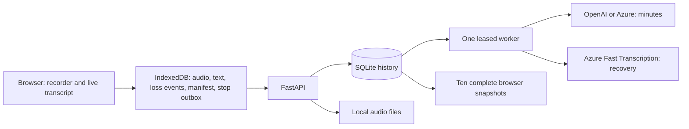

# Architecture

The [visual architecture diagram](architecture/index.html) documents the current local implementation and its cloud connections. Download the [editable diagrams.net file](architecture/meeting-intelligence-architecture.drawio), [SVG](architecture/meeting-intelligence-architecture.svg), or [PNG](architecture/meeting-intelligence-architecture.png). The [diagram notes](architecture/README.md) explain the boundaries and source evidence.

This is a local, single-user meeting application. React/TypeScript handles capture and review; FastAPI handles authenticated data access; one Python worker executes durable SQLite jobs. Compose uses PostgreSQL with a shared audio volume.

## Recording and synchronization

MediaRecorder captures WebM audio while Azure Speech produces live segments. Online meetings default to a mono Web Audio mix of microphone and shared tab/system audio; both recording and Speech receive that same stream. In-person microphone-only and shared-audio-only modes remain available. Sharing video stays active for the source's lifetime but is never recorded or uploaded. Missing shared audio blocks online capture; losing either input stops capture and records an interruption. The local recorder and monotonic stopwatch pause immediately, before waiting for cloud callbacks. Asynchronous capture responses are checked against the selected meeting, request generation and server revision.

IndexedDB commits audio, transcript segments, interruption events and stop requests before acknowledging local persistence. Synchronization sends interruption events first, then audio and text, then the recording manifest, then Stop. Failed acknowledgements retain the original data. Never clear browser storage while recovery data is pending. Closing a recording tab marks the restored session incomplete; an unsaved final chunk cannot be reconstructed by pretending the session finished normally.

The manifest records the expected chunk count, final timeline and intentional pause intervals. Coverage checks detect missing sequences, missing tails and unexpected gaps. Silence is not classified as missing speech. Legacy recordings without a manifest remain available but cannot claim verified audio completeness.

Live Speech uses `ConversationTranscriber`. Each segment retains its service speaker ID,
scoped to a unique transcription session so reconnects cannot inherit the wrong person's
name. The `speaker_names` table stores manual names separately from immutable transcript
events. Transcript responses and browser snapshots include that mapping; renames are
authorized against the meeting owner, require an existing speaker, and are audited.
Names apply to transcript display and evidence, without rewriting approved minutes.

## Recovery and minutes

The Recover transcript action queues a job using saved audio only. The worker checks checksums and manifest coverage, joins WebM timeslices, decodes with bundled FFmpeg, validates the audio duration and sends WAV to Azure Fast Transcription. Returned phrase timings are mapped around pauses. Original live segments remain stored; the verified recovered version becomes the displayed transcript. Only verified recovery acknowledges the specific loss events it covered. A later loss report blocks generation again. No timed speech, bad checksums, missing chunks, changed recordings or malformed provider output leave the loss unresolved.

Generate MoM queues a leased job. Long transcripts are summarized in sections; successful sections survive retries and worker restarts. Typed HTTP failures honor Retry-After or exponential backoff with jitter. Invalid output gets one retry. Strict JSON Schema is requested by default, then Pydantic validates required fields and rejects unsupported fields; decisions/actions must cite existing evidence. Compatible providers may explicitly select JSON-object mode.

The UI polls active jobs, retains accepted job IDs across transient refresh failures and preserves unsaved edits. The document review screen shows title, summary, discussion, decisions, actions, risks/plans and questions. Supporting transcript is available from evidence links. Draft edits and generated results keep revisions, and generated revisions record model, schema, prompt version and transcript fingerprint. Approved records are immutable; Create new revision explicitly starts a new draft while retaining the approved version.

## Storage and retention

New installations default to the OS local application-data directory: on Windows, `%LOCALAPPDATA%/MeetingIntelligence`. Explicit relative overrides remain anchored to `backend/` for compatibility. Existing project-folder databases can be relocated with `run.py migrate-storage` while all services are stopped. Migration creates a checksum-verified database/audio archive, restores to a new folder and then updates only the storage paths in `.env`. Original files remain intact.

SQLite holds meetings, segments, chunk metadata/checksums, manifests, jobs/checkpoints, current minutes, immutable revisions, worker heartbeat and audit events. Audio bytes live in files. Foreign keys and a bounded busy timeout are enabled. The database is suitable for one local worker; PostgreSQL/multi-worker deployment needs separate qualification.

All transcript and minutes history is retained. The history API supports search and pagination beyond 100 records. The browser keeps the latest ten complete read snapshots, incrementally refreshed by revision. That limit trims only the read cache, never pending uploads or backend history. Offline viewing requires the frontend to be available; this is not an installed offline PWA.

Audio deletion is disabled by default. Explicit `AUDIO_RETENTION_ENABLED=true` enables age-based cleanup of verified, approved recordings, protecting the latest ten meetings, active jobs, legacy recordings and incomplete sessions. Text, minutes and revisions are not deleted. Download full backup creates a consistent SQLite snapshot plus every referenced audio file and a checksum manifest, excluding credentials. Restore verifies all files before writing an empty destination and refuses to overwrite existing history.

## Startup, identity and checks

`run.py` supervises API, worker and UI, holds a single-instance lock, checks ports and initializes the schema before dependent processes start. It stops only its own child processes. `/api/ready` reports database and recent worker heartbeat separately. An available UI/API does not imply valid cloud credentials or adequate provider quota.

The development Vite proxy reads APP_API_TOKEN server-side and accepts loopback/same-origin requests only. Provider keys never enter browser bundles. Production builds require an explicit API token; the current actor is one local user. Shared deployment requires real identity/authorization, TLS, encryption policy, audit export and operational qualification.

Tests include isolated backend/provider/recovery/backup cases, frontend persistence/clock/proxy cases, and real-browser synthetic recording and failure scenarios. Windows CI runs browser regressions without cloud secrets; live provider qualification is a separate bounded manual test. Dependency versions are pinned and constrained by `backend/requirements.lock`; frontend installs use `npm ci`.

## Source layout

- `backend/app/main.py`: API boundaries and meeting lifecycle.
- `backend/app/recovery.py`: manifests, loss evidence and verified audio recovery.
- `backend/app/worker.py`: leases, checkpoints, retries and worker health.
- `backend/app/providers.py`: Speech/LLM transports and response validation.
- `backend/app/storage.py`: backup, restore, storage status and opt-in audio retention.
- `frontend/src/main.tsx`: application flow and capture orchestration.
- `frontend/src/audioCapture.ts`: microphone/shared-audio acquisition, mixing and source cleanup.
- `frontend/src/offline.ts`: durable outboxes and ten-snapshot cache.
- `frontend/src/MinutesReview.tsx`: editable document and revision review.
- `frontend/src/StorageSettings.tsx`: storage status and verified backup download.
